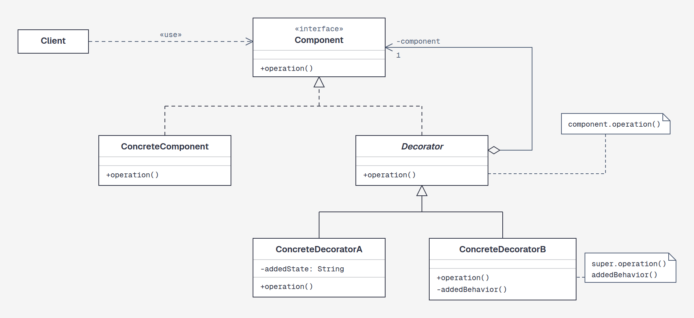
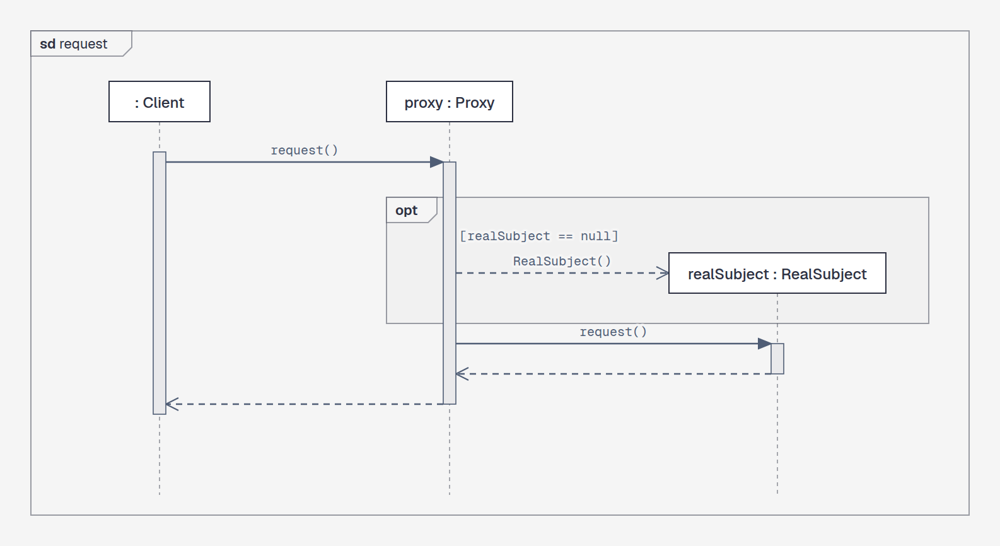
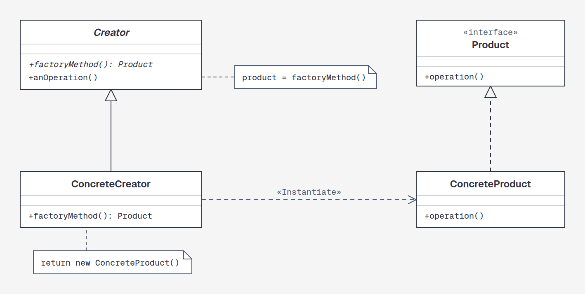
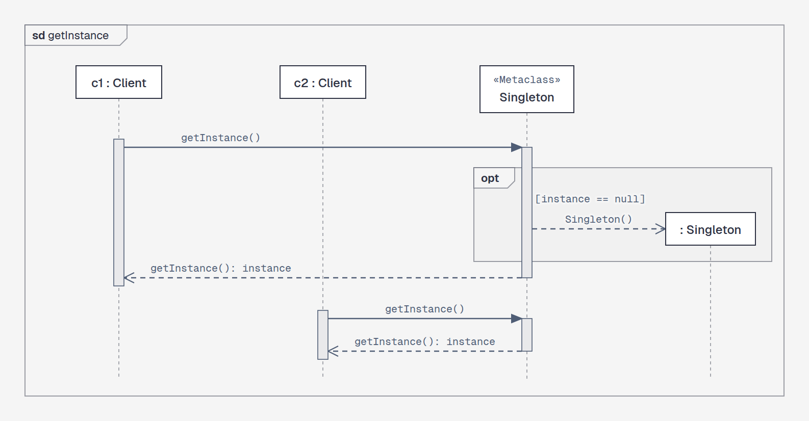

# create-uml-seq-diagram

An agent skill for **Claude Code** and **Codex** that draws **UML class diagrams** and **UML sequence diagrams** in standard OMG UML 2.5.1 notation. The output is at the level a strict examiner would give full marks: every symbol is standard and nothing optional is added.

The agent does not hand-draw SVG. It models the diagram in text, then places boxes with a small Python library (`scripts/umlsvg.py`) that fixes the notation: arrowheads, line styles, `sd` frames, fragments, guillemets, italics for abstract elements and underlines for static members. A checker (`scripts/check_uml.py`) rejects non-standard input and uses headless Chrome to verify that no label overlaps another label or a shape. The result is a self-contained HTML page with inline SVG. SVG or PNG export is available on request.

## Examples

These come from the bundled GoF examples (`assets/examples/gof_patterns.py`).

**Decorator, class diagram**

**Proxy, sequence diagram**

**Factory Method, class diagram**

**Singleton, sequence diagram**

## What it covers

- **Class diagrams:** classes, interfaces, abstract classes, enumerations, attributes and operations in UML syntax, static members, generalization, interface realization, associations with roles, multiplicities and navigability, aggregation, composition, dependencies (`«use»`, `«Instantiate»`) and notes.
- **Sequence diagrams:** the `sd` frame, lifelines and actors, activation bars, synchronous, asynchronous, reply, create, delete and found messages, self calls, and `alt` / `opt` / `loop` / `par` / `break` fragments with guards.

Features that go beyond exam level (packages, constraints, gates, `ref` and so on) are deliberately not supported. This keeps agents from adding them. `references/rationale.md` explains every choice.

## Installation

See the [installation guide](../../README.md#install) of this repository: user or project level, for Claude Code, Codex and other agents. The skill's name is `create-uml-seq-diagram`. The agent loads it on its own when you ask for a UML class or sequence diagram; you can also call it with `/create-uml-seq-diagram` in Claude Code or `$create-uml-seq-diagram` in Codex.

## Requirements

- Python 3.10 or newer. No packages are needed.
- Google Chrome or Chromium for the render check, the screenshots and the PNG export. Without Chrome, the static checks still run.
- The diagrams use the Geist font from Google Fonts and fall back to Arial when offline.

## Usage example

> Draw the UML class diagram and the sequence diagram of the Observer pattern.

The agent writes a short build script from `assets/template.py`, runs it, checks the page with `check_uml.py --render --shot`, looks at the screenshot, and delivers the HTML page.

## Credits and license

MIT. Forked from [diagram-design](https://github.com/cathrynlavery/diagram-design) by Cathryn Lavery (MIT). This skill keeps its colour palette and typography and replaces its diagram rules with the UML 2.5.1 notation. See [LICENSE](LICENSE).
